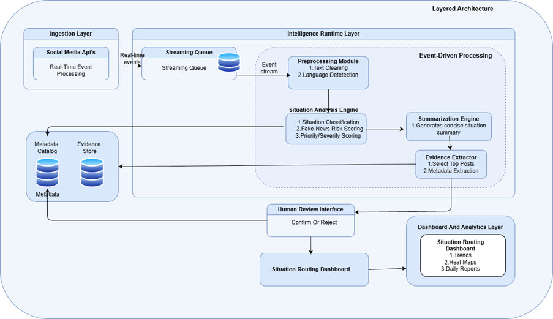
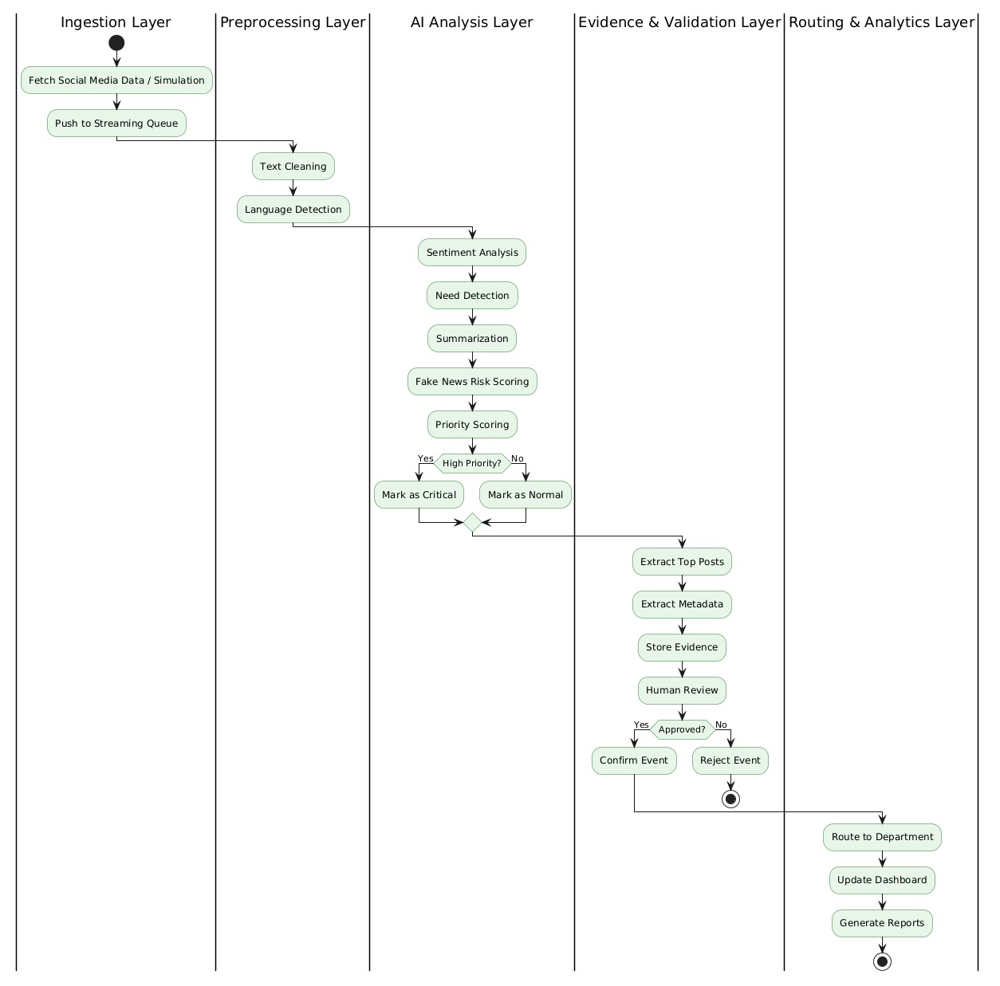

# Multilingual Sentiment & Need Detection for Real-Time Crisis Monitoring and Departmental Routing

**Capstone Project 160** · Guide: Dr. Saritha

A real-time, multilingual system that analyzes social media posts during crises and emergencies to detect **sentiment**, **urgent needs**, and **fake/misleading content**, then routes verified, prioritized alerts to the appropriate government department (Disaster Management, Healthcare, Law & Order, Public Safety, Transportation, and Public Municipal).

## Problem Statement

During crises, people share information, emotions, and help requests on social media in multiple languages — often with code-mixing and mixed sentiment that make automated analysis hard. Existing sentiment analysis tools are largely English-only, don't detect actual *needs*, can't tell credible posts from misinformation, and offer no automated routing to the departments that need to act. This leads to delayed, inefficient crisis response.

This project builds a real-time multilingual pipeline that detects sentiment and needs from social media data, scores posts for credibility and priority, and routes them to the relevant department for timely action — with a human reviewer in the loop before anything is dispatched.

## Objectives

*Why we are building this: the outcomes the system should deliver.*

1. **Include every language people use.** Crisis posts in Indian languages, including romanised and code-mixed text, should be understood and not ignored because they are not in English.
2. **Turn reactions into actionable needs.** The system should find out what help people are asking for and which department should provide it, not only how they feel.
3. **Keep rumours from triggering a response.** The system should estimate how likely a report is to be misinformation, so responders do not act on rumours.
4. **Put the most urgent situations first.** Situations should be ranked by an explainable priority, so limited response capacity goes where it is needed most.
5. **Reduce the reviewer's workload.** Many posts about one event should become one situation with a summary and evidence, so reviewers verify an event once instead of reading every post.
6. **Keep humans in control without delaying urgent cases.** Every alert should be confirmed by a person before routing, but urgent situations should not wait indefinitely in the review queue.
7. **Give departments a clear view of the crisis.** Departments should be able to see trends, workload and response times to plan their response.

## Scope

*What exactly the project builds, and where it stops.*

**In scope**

- **Languages:** English, Hindi, Kannada, Tamil and Telugu, in native script or romanised; code-mixed posts are flagged.
- **Input:** text-only social media posts, streamed from a CSV simulator into an in-memory queue.
- **Post analysis:** cleaning, repost detection, language detection, disaster filtering, sentiment (negative/positive) and multi-label need detection (healthcare, municipal, law, tourism).
- **Situations:** related posts, including posts in different languages, are grouped with IndicSBERT embeddings. A cluster becomes a situation once it has three or more posts.
- **Scoring and evidence:** an explainable priority score (Critical / High / Medium / Low) and a formula-based fake score for each situation. Each situation also gets a template summary in all five languages and its top supporting posts, with personal details masked.
- **Validation and routing:** a reviewer console (Approve / Mark Fake / Skip) and one ticket per relevant department: Healthcare, Public Municipal, Law & Order or Tourism, with Disaster Management as the fallback. Critical situations are auto-escalated after 1 minute and High after 5 minutes if no one reviews them.
- **Monitoring:** a live dashboard with trends, heatmaps (department × hour, need × language), department workload and daily reports.

**Out of scope**

- Images, video and audio in posts.
- Languages other than the five listed above.
- A trained fake-news classifier. The fake score is an explainable formula over credibility, content risk and amplification.
- Geographic mapping. Place names are extracted from the post text, but posts are not geocoded or shown on a map.
- Connecting directly to live platform APIs or to real government systems. The system raises tickets but does not dispatch responders.
- Production deployment concerns: a persistent message broker, per-department logins and access control.

## Architecture

The system is organized into five layers: **Ingestion → Preprocessing → AI Analysis → Evidence & Human Validation → Routing & Analytics**.


**Pipeline**

1. Ingestion (Devraj)
2. Preprocessing — cleaning + dedup (Devraj)
3. Disaster Classification gate (Favaz)
4. Language Detection (Favaz)
5. Sentiment Analysis (Akshata) + Need Detection (Favaz) — parallel
6. Combine step (Devraj) — merges 3,4,5 → adds severity, actionability
7. Embedding Generation (Akshata) — IndicSBERT vectors
8. → CLUSTERING (Akshata) ← YOU ARE HERE
9. Fake-News Scoring (Christa) + Priority Scoring (Akshata) — run right after, using clusters from step 8
10. Evidence Extraction (Christa/Devraj) — needs step 8 (clusters) + step 9 (priority)
11. Summarization (Akshata)
12. Store Evidence + privacy masking (Christa/Devraj)
13. Human Review (Christa)
14. Confirm/Reject → Feedback loop / Route to Department (Devraj)
15. Dashboard/Reports (Devraj)

**Layers**

| Layer | Responsibility |
|---|---|
| Ingestion Layer | Pulls real-time posts from social media APIs into a streaming queue |
| Preprocessing Module | Text cleaning (URLs, mentions, hashtags, emojis) and language detection |
| Situation Analysis Engine | Situation/disaster classification, fake-news risk scoring, priority/severity scoring |
| Summarization Engine | Generates a concise summary of the detected situation |
| Evidence Extractor | Selects top supporting posts and extracts metadata |
| Human Review Interface | Reviewer confirms or rejects the AI-generated result before routing |
| Situation Routing Dashboard | Routes confirmed cases to the correct department; shows trends, heatmaps, daily reports |
| Metadata Catalog / Evidence Store | Persists processed metadata and supporting evidence |

**End-to-end data flow**



1. **Ingestion** — fetch/simulate social media posts, push to a streaming queue.
2. **Preprocessing** — clean text, detect language.
3. **AI Analysis** — sentiment analysis → need detection → summarization → fake-news risk scoring → priority scoring → critical/normal classification.
4. **Evidence & Validation** — extract top posts and metadata, store evidence, human review (approve/reject).
5. **Routing & Analytics** — route confirmed events to the owning department, update the dashboard, generate reports.

## Models & Methods

| Task | Approach |
|---|---|
| Sentiment analysis | Fine-tuned **XLM-RoBERTa**; zero-shot fallback via **mDeBERTa-v3-base-mnli-xnli** / **BART-large-MNLI** |
| Disaster / crisis classification | Fine-tuned **BERTweet-base** |
| Need detection | Multi-label **XLM-R** classifier (Healthcare, Law, Public Services, Tourism, …), zero-shot NLI fallback |
| Department routing | Zero-shot **BART-large-MNLI**, and an **SBERT**-based semantic similarity + keyword-boost classifier |
| Fake news / credibility | Rule-based formula: credibility + content risk (forwarding, hearsay, writing style) + copy-paste amplification risk |
| Summarization | **mT5** |
| Evidence ranking | Sentence embeddings (Sentence-BERT / LaBSE) + similarity-to-priority weighted ranking |

**Scoring formulas**

- **Priority score** = 0.30 × Severity + 0.25 × Actionability + 0.20 × Corroboration + 0.15 × Credibility + 0.10 × Recency
- **Fake score** = 0.385 × (1 − Credibility) + 0.230 × Content Risk + 0.385 × Amplification Risk
- **Credibility** = 0.35 × Cluster Consistency + 0.30 × Text Quality + 0.20 × Model Confidence + 0.15 × Specificity
- **Content risk** = 0.50 × Forward-Chain Keywords + 0.25 × Hearsay Keywords + 0.25 × Writing Style
- **Amplification risk** = 0.45 × Duplicate Ratio + 0.30 × Copy Burst + 0.25 × Forward Ratio

**Stack:** Python, PyTorch, Hugging Face Transformers, Sentence-Transformers, scikit-learn, Pandas/NumPy, FastAPI (ingestion/queue services), MongoDB (storage).

## Datasets

| Dataset | Purpose |
|---|---|
| [XNLI](https://github.com/facebookresearch/XNLI) | Multilingual semantic foundation / cross-lingual pretraining |
| [CrisisLex T15](https://crisislex.org/data-collections.html) | Actionable need detection (disaster-related labeled tweets) |
| [DravidianCodeMix](https://github.com/bharathichezhiyan/DravidianCodeMix-Dataset) | Code-mixed language identification (Tamil/Malayalam/Kannada-English) |
| SentiMix (SemEval-2020) | Code-mixed sentiment (Hinglish) |
| Disaster Tweets (Kaggle) | Disaster vs. non-disaster tweet classification |
| AI4Bharat multilingual sentiment | Indic-language sentiment (Hindi, Kannada, Tamil, Telugu) |
| TweetEval | Large-scale real-world sentiment/keyword extraction |


## Project Structure

Standard 3-tier split: **React** (presentation) → **FastAPI** (application/API) → **MongoDB** (storage), in explicit `backend/` / `frontend/` folders. The backend is a *modular monolith* — a single FastAPI app, one process — with every HLD layer as its own router (`backend/app/routers/<layer>.py`) so a member can own a layer's code without needing to run or coordinate a separate service for it. The frontend covers the two human-facing HLD screens. Full rationale in [docs/TECH_STACK.md](docs/TECH_STACK.md).

```
capstone-160/
├── backend/                  # single FastAPI app (modular monolith)
│   ├── app/
│   │   ├── main.py            # app instance, CORS, router registration
│   │   ├── db.py               # MongoDB (motor) client
│   │   ├── schemas/             # shared Pydantic models
│   │   ├── analysis/             # sentiment / need_detection / fake_news / priority_scoring helpers
│   │   └── routers/
│   │       ├── ingestion.py      # done — POST /ingestion/ingest
│   │       ├── queue.py           # done — in-memory FIFO queue
│   │       ├── preprocessing.py    # scaffold — text cleaning, language detection
│   │       ├── analysis.py          # scaffold — sentiment, need detection, fake-news, priority
│   │       ├── summarization.py      # scaffold — situation summarization
│   │       ├── evidence.py            # scaffold — evidence extraction + evidence store
│   │       └── situations.py           # scaffold — API the frontend calls (review + analytics)
│   └── tools/                 # simulator / consumer scripts (not part of the API process)
├── frontend/                  # React + Vite
│   └── src/pages/
│       ├── ReviewPage.jsx      # scaffold — Human Review Interface
│       └── DashboardPage.jsx   # scaffold — Situation Routing Dashboard
└── docs/                     # architecture diagrams, tech stack notes, ESA decks
```

Run:

```bash
# backend — one process, one port
cd backend
pip install -r requirements.txt
uvicorn app.main:app --reload --port 8000

# frontend — separate dev server, proxies API calls to the backend
cd frontend
npm install
npm run dev   # http://localhost:5173
```

Test the pipeline as currently implemented (`backend/tests/`, no real network/MongoDB
needed — Mongo is mocked in-memory): `cd backend && python -m pytest -v` (use
`python -m pytest`, not a bare `pytest` — with more than one Python install, a
`pytest` on PATH can silently resolve to a different one than `pip install` used,
which looks like the packages "aren't installed" when they are). Or open VS Code's
Testing panel and click ▶ — test discovery is pre-configured in `.vscode/settings.json`,
but make sure the interpreter selected in VS Code's status bar is the same one you
ran `pip install -r requirements.txt` with.

To see a separate readable input/output trace of the main flow without running
pytest, run `python backend/tools/trace_pipeline.py`. This offline trace
uses deterministic model stubs and an in-memory MongoDB, then prints the results
of preprocessing, analysis, clustering, evidence extraction, and evidence storage.

End to end: start the backend (its background worker drains the queue through every step),
stream the sample data in with `python tools/simulator/csv_producer.py` from `backend/`, then
review the resulting situations in the frontend. Without torch/transformers installed the
backend falls back to offline keyword/hashing stand-ins for the models (`MODEL_BACKEND`, see
[backend/README.md](backend/README.md#end-to-end-pipeline)); install the full
`requirements.txt` to use the fine-tuned models. `backend/app/routers/situations.py` is the
API contract the React frontend calls (`GET /situations`, `POST /situations/{id}/decision`,
`GET /analytics/summary`), backed by MongoDB.

## Team

Project ID 160 — Guide: **Dr. Saritha**

| Name | SRN | Contribution |
|---|---|---|
| Akshata Udaganve | PES2UG23CS043 |
| Christananda B | PES2UG23CS158 |
| Devraj Ishwar Naik | PES2UG23CS167 |
| Favaz Ahmed Alam | PES2UG23CS190 |
